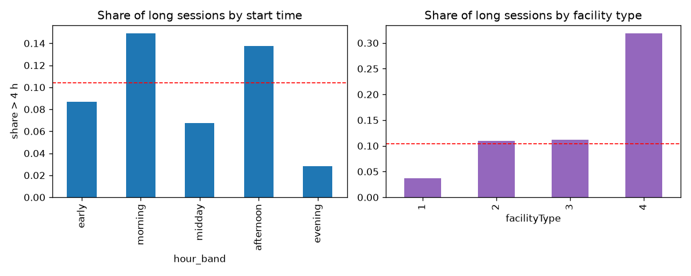
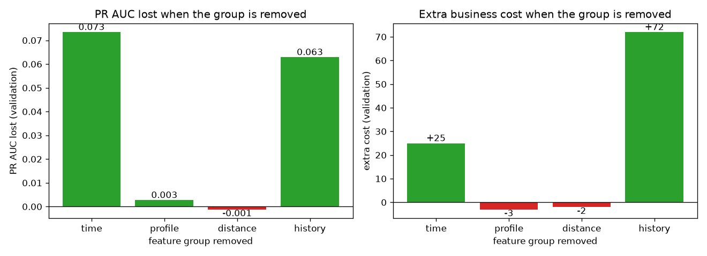
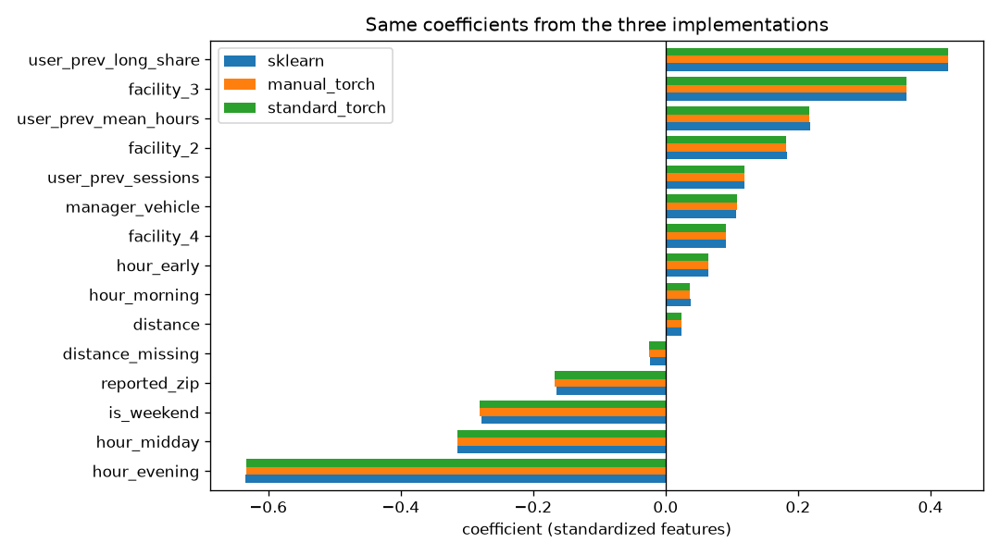
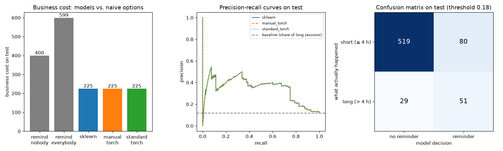

# Assignment 1 Report
- **Name**: Sofia Hervas
- **Student ID**: 18936
- **Email**: shervas.ieu2022@student.ie.edu
- **Group**: BBADBA 5B

## Dataset

The dataset comes from Harvard Dataverse and is part of a field experiment led by Professor Omar Asensio on electric vehicle charging in the workplace. It contains information about charging sessions, including when they start and end, how much energy is consumed, the cost, and details about the drivers, locations and chargers used.

Each row is one charging session. The dataset contains 3,395 charging sessions and 24 columns, covering the period from November 2014 to October 2015. It includes 85 drivers, 105 chargers and 25 different sites.

I chose this dataset because it allows me to work with real data and apply what I have learned to a practical problem. When chargers are shared between employees, leaving a car plugged in for too long can prevent someone else from using it. I found it interesting to explore whether a model could help predict these situations and make better use of the available chargers. The dataset also has a clear time dimension, which makes decisions about the target, the features and the train-test split particularly important.

## Business / real-life framing

The scenario I considered is a company that provides charging stations for its employees, but the number of chargers is limited. When an employee leaves their car plugged in for too long, other colleagues may not be able to use the charger when they need it.

The idea is to use a model to predict, when a charging session starts, whether it will last more than four hours. If the model predicts that it will, the company could send the employee a reminder to move their car once charging is finished. This would help make better use of the available chargers without immediately needing to install more of them.

I defined the target as a binary variable: 1 if the charging session lasts more than four hours and 0 otherwise. Only around 11% of sessions exceed this limit, so the target is quite unbalanced. Accuracy alone would therefore be misleading. A model that always predicts that a session will last less than four hours would still be correct around 89% of the time, but it would never identify a session that could cause a problem.

Since predictions are made at the start of a session, I only included information available at that moment. I excluded variables such as total energy consumed, cost, end time and charging duration because they are only known later. Including them would cause data leakage and make the model's performance look better than it would be in practice.

I also used a chronological 60/20/20 split for training, validation and testing. In practice, a company would train the model on past sessions and use it to predict future ones. Keeping the data in chronological order better reflects this situation and avoids using later sessions to predict earlier ones. The validation set was used to select the decision threshold, while the test set was kept for the final evaluation.

Finally, I considered the consequences of the two types of errors. A false negative means failing to identify a session that will last more than four hours, potentially preventing a colleague from using the charger. A false positive means sending an unnecessary reminder. I assumed that a false negative costs five times as much as a false positive, giving a cost ratio of 5:1. Based on this assumption, the theoretical threshold is approximately 0.17. I selected a threshold of 0.18 using the validation set to balance these two types of errors and reduce the expected business cost. This is why I focused on recall and business cost rather than relying on accuracy alone.

## Data preparation & feature engineering

I started by cleaning the dataset and checking which variables could actually be used to make a prediction when a charging session begins. The dates had an issue with the year, which appeared as 0014 instead of 2014, so I corrected the format before working with the time-based split. I also found that distance was missing in 1,065 of the 3,395 sessions.

One of the most important decisions was to remove five columns that could cause data leakage because their values are only known at the end of a charging session. Since the goal is to predict long sessions when they start, using this information would make the model look better than it would perform in practice.

I then created several features to capture different aspects of charging behaviour. For the time of day, I used one-hot encoding to group sessions into time slots instead of treating the hour as a continuous number. This made more sense because the relationship with long sessions does not simply increase or decrease throughout the day, as shown in the figure below. I also added an indicator for weekends, since charging behaviour may differ between weekdays and weekends.

For the driver's and charging site's profile, I converted `facilityType` into one-hot variables because it represents categories rather than numerical values. I also included `managerVehicle` and `reportedZip` to account for possible differences between drivers and locations.

Distance required some additional treatment because so many values were missing. I created a separate indicator for missing values and filled the gaps using the median calculated from the training set. I also found that sessions with missing distance were more likely to last over four hours (15%, compared with 9% for sessions with a recorded distance). This suggested that missingness itself could contain useful information, rather than being something to ignore.

The most useful features came from the driver's previous charging history. I calculated the number of previous sessions, the proportion of previous sessions lasting over four hours, and the average duration of previous sessions. These features help the model identify patterns in how different drivers use the chargers. To avoid leakage, I used `shift()` so that each session only included information from earlier sessions, never from the session being predicted or anything that happened afterwards. For drivers without any previous sessions, I used the corresponding averages from the training set.

Finally, I standardised all features using `StandardScaler`. Both the scaler and the median used to fill missing distances were fitted using only the training data. This was important to avoid using information from the validation or test sets during preprocessing.

To understand which features were actually helping, I also tested the model after removing different groups. Removing the historical features increased the validation business cost from 252 to 324, making history clearly the most useful group. Removing the time features increased it to 277. In contrast, removing the profile or distance features resulted in costs of 249 and 250, respectively, which were slightly better than the full model's cost of 252.

The profile and distance features did not improve the validation results, but I decided to keep them. One possible explanation is that the driver's previous charging history already captures some of the differences between facilities and drivers, making the profile features less useful than they initially seemed. Although the facility type looked important in Figure 3, its effect may already be reflected in the historical patterns. For distance, the missing values may contain some information, but the feature itself does not seem to add much to the model. The differences in business cost were only two or three points in a single month of validation, so they could simply be due to random variation. Removing features based on such a small difference could mean adjusting the model to noise rather than improving its performance. I therefore kept them, although further testing on additional time periods would be needed to know whether they actually help.

## Modeling: three implementations, one model

I chose logistic regression because the target has two possible outcomes: whether a charging session lasts more than four hours or not. It also gives a probability for each session, which allows me to choose a threshold based on the cost of the two types of errors.

I implemented the model in three ways: using scikit-learn, writing the training loop manually in PyTorch, and using PyTorch's standard nn.Module and torch.optim workflow. For scikit-learn, I selected C = 0.1 based on the validation results, although different values of C gave very similar performance. In the manual PyTorch version, I used SGD with a learning rate of 0.5, since 0.01 did not reach a sufficiently low training loss within 2,000 epochs. For the standard PyTorch version, I used Adam with a learning rate of 0.01. A value of 0.001 was too low, while 0.1 made the training less stable. I chose these learning rates by comparing how well each setting minimised the training loss.

An important part of the comparison was making sure that all three implementations used the same L2 regularisation penalty, applied only to the weights and not the bias. This required adjusting the penalty because scikit-learn adds it to the sum of the losses, while my PyTorch implementations use the mean loss. I therefore used l2_lambda = 1/(2·C·n), where n is the number of training rows. Without this adjustment, the PyTorch models would have been less regularised, and their coefficients would not have matched those from scikit-learn as closely.

The results were almost identical across the three models. Their coefficients differed by less than 0.003 and their predicted probabilities by less than 0.0008. This is because all three implementations use the same logistic regression model, data and regularisation. The small differences come from the fact that each optimiser stops at a slightly different point and that PyTorch uses float32, while scikit-learn uses float64, which provides greater numerical precision.

| Model | Log loss | ROC AUC | PR AUC | Threshold | Recall | Precision | Business cost |
|---|---:|---:|---:|---:|---:|---:|---:|
| Naive baseline | 0.364 | 0.500 | 0.118 | – | 0.000 | – | 400 |
| scikit-learn | 0.301 | 0.791 | 0.346 | 0.18 | 0.638 | 0.389 | 225 |
| Manual PyTorch | 0.301 | 0.791 | 0.346 | 0.18 | 0.638 | 0.389 | 225 |
| Standard PyTorch | 0.301 | 0.791 | 0.346 | 0.18 | 0.638 | 0.389 | 225 |

For the business decision, I assigned a cost of 5 to a false negative and 1 to a false positive, because missing a session that blocks a charger is more costly than sending an unnecessary reminder. This gives a theoretical threshold of approximately 0.17. I selected 0.18 using the validation set, rather than choosing it based on the test results.

On the test set, the models achieved a recall of 0.638 and a precision of 0.389. This means that they identified 51 of the 80 long sessions, while missing 29. They also generated 80 unnecessary reminders. The resulting business cost was 225, compared with 400 for the baseline that never sends a reminder. This represents a reduction of around 44% in the assumed business cost.

The test results were slightly worse than the validation results, with a PR AUC of 0.346 compared with approximately 0.39. The main reason is that the test set covers a later month that the model had never seen during training or validation. This is a direct consequence of the chronological split, which better reflects how the model would be used in practice. Differences in the sessions observed during each period can affect performance, especially when the number of long sessions is limited.

## Limitations & next steps

One limitation is that the test set contains only 80 long charging sessions. This means that even a small change in the number of sessions correctly identified can noticeably affect the results. With more data, I would evaluate the model on a larger test set to get a more reliable picture of its performance.

Another issue is how the target is defined. More than a quarter of the long sessions last between four and 4.2 hours, which makes them very similar to sessions that finish just before the four-hour limit. The model cannot always distinguish between these cases using the available information. I would look at different time limits and discuss with the company which one would be most useful in practice.

The model also relies heavily on drivers' previous charging history. However, 15 drivers appear for the first time in the test set, so there is no previous history available for them. At the moment, these drivers receive the average values calculated from the training set. With more data, I would collect additional information about new drivers or investigate ways to make predictions when no previous sessions are available.

Another limitation is that the validation and test sets each cover only one month. Since the charging programme grew considerably over time, these periods may not represent other months or seasons. I would test the model on several later periods to check whether its performance remains stable as usage patterns change.

Finally, the cost ratio of 5 to 1 is an assumption rather than a value measured from real business data. I would discuss with the company the actual impact of missed sessions compared with unnecessary reminders and adjust the threshold accordingly. This would make the model's decisions more closely reflect the company's needs.

## Generative AI use disclosure
I used Claude (Anthropic) as an assistant throughout this assignment. I came up with the project idea myself and used Claude to check whether the dataset I had found was suitable for the assignment. It also ran an initial exploration of the data, including checking date format issues, missing values, and the share of sessions above different duration cutoffs. It wrote most of the code in `train.ipynb` and `app.ipynb` based on decisions I made, explained each step to me, and helped me understand the code. For the report, it suggested the questions I should answer and the topics I should cover in each section to make sure I did not leave anything out. It also helped with grammar checking and formatting the variables consistently using code formatting, such as `facilityType` and `managerVehicle`. The main decisions were mine: the topic, the 4-hour target, using a chronological split, the 5:1 cost ratio, which feature groups to include, and keeping the profile and distance features after the ablation. I worked through the code cell by cell so I can explain every step without it.